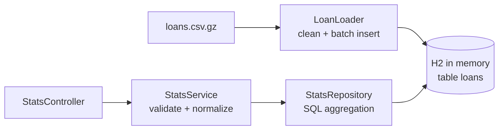

# Loan Stats

A small backend that loads Lending Club loan data and aggregates it on request
through one REST endpoint. A front end can chart any slice by date, state, grade or FICO band.

Kotlin, Spring Boot 4, plain Spring JDBC, in-memory H2.

## How to Run

You need JDK 17 or newer. Nothing else required: no database, no unzip.

```
./gradlew bootRun
```

Wait for the log line `Loaded x of x rows` (about 15 seconds), then open
**http://localhost:8080/swagger-ui.html**

Tests:
```
./gradlew test
```

## Endpoint

GET /loans/stats: all parameters are optional and filters are combined with AND.

| Parameter | Meaning |
|---|---|
| `start`, `end` | first and last month, `yyyy-MM`, both inclusive |
| `state` | state code, any case |
| `grade` | `A` to `G`, any case |
| `ficoBand` | `Poor`, `Fair`, `Good`, `Very Good` or `Exceptional`|
| `groupBy` | `grade`, `state`, `month`, `ficoBand` or `purpose` |

No groupBy gives you a single overall row. With it you get one row per group, sorted by the group value

```
curl "http://localhost:8080/loans/stats?state=CA&grade=B&start=2017-10&end=2017-12&groupBy=month"
```
```json
[{"group":"2017-10","count":1749,"totalAmount":26575325.00,"avgAmount":15194.58,"avgRate":10.52,"medianRate":10.42,"avgDti":16.44}, ...]
```


## How it works



- At startup `LoanLoader` will stream the gzipped CSV, clean each row and batch insert it into the `loans` table.
- Requests go to the controller, then the service, then the repository. 
- Filter values are always bound parameters, and the
`GROUP BY` text comes from the GroupBy enum.

**Table `loans`** (8 of the file's 150 columns, plus one derived):

- `loan_amnt` (DECIMAL): parsed as a number
- `int_rate` (DECIMAL): `" 13.5%"` becomes 13.5
- `grade` (VARCHAR, not null): trimmed; the row is dropped if it is missing
- `issue_d` (DATE, not null): `Dec-2017` becomes 2017-12-01; the row is dropped if it is missing or unreadable
- `purpose` (VARCHAR): trimmed
- `addr_state` (CHAR(2)): trimmed and upper-cased
- `dti` (DECIMAL): below 0 or above 100 becomes NULL (the 999 placeholder); the loan is kept
- `fico_range_low` (INT): parsed as a number
- `fico_band` (VARCHAR): derived from `fico_range_low` at load time

**Cleaning rules:**

- Text is trimmed.
- Blank, `.` and `n/a` become NULL.
- A value that cannot be parsed becomes NULL, and the row still loads.
- The note line, the footer lines and the rows without a grade or issue date are dropped.
- The log says how many rows were loaded and dropped, for example `Loaded 118636 of 118638 rows`.

## Decisions and trade-offs

- Used in-memory H2, rebuilt on every start. With this there is zero setup for a reviewer and 118k rows are tiny. The cost is a load of about 8 seconds after startup (during which the API returns empty results). A real service would load once into a Persistent database such as Postgres
- No indexes. At this size a scan is going to take milliseconds and the filter columns have very few distinct values. They would be the first thing to do is to add some more data
- Both the average and median rate. The average will be pulled up by a few very high rates so the median is given alongside it similar to the provided example


With more time: indexes on the filter columns, a readiness check whilst loading and more columns.